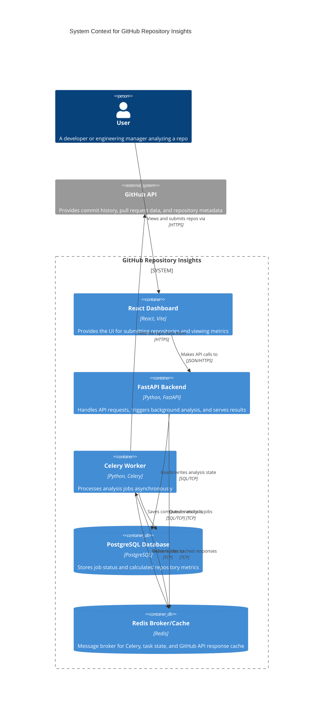
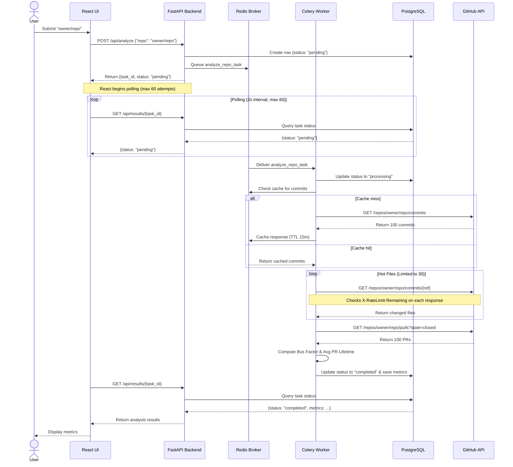

# System Architecture

## Context Diagram

## Sequence Diagram: Analysis Flow

## Calculation Logic Explained

- **Bus Factor**: The application parses the author login/name from the most recent 100 commits. It tallies the number of commits per distinct author, sorts them in descending order of contribution, and determines the minimum number of authors required to account for exactly 50% or more of the total commits. If 10 developers made 100 commits, but 1 developer made 55 of them, the bus factor is 1.
- **Hot Files**: The application inspects the diff/files output for the latest 30 commits. It counts how many distinct times each file path was modified across those commits. The paths are sorted by modification frequency, and the top 10 are returned. This indicates the most volatile code areas.
- **Average Pull Request Lifetime**: The application fetches closed and merged pull requests. It parses the `created_at` timestamp and the `closed_at` (or `merged_at`) timestamp, converting the difference to hours. It then averages these lifespans across all fetched PRs to produce a single metric representing how long PRs sit open on average. Returns `null` when no valid (closed/merged) PRs are found.

## Caching Strategy

GitHub API responses are cached in Redis with a configurable TTL (default: 15 minutes, controlled by `CACHE_TTL_SECONDS`). Every request to the GitHub API goes through a central `github_get()` helper that:

1. Checks Redis for a cached response keyed by the URL + query parameters (SHA-256 hash).
2. On a cache hit, returns the cached JSON immediately — no HTTP request is made.
3. On a cache miss, makes the HTTP request and stores the response in Redis with the configured TTL.

If Redis is unavailable (e.g. local development without Docker), caching degrades gracefully — requests go directly to the GitHub API.

## Rate Limit Handling

The `github_get()` helper inspects `X-RateLimit-Remaining` and `X-RateLimit-Reset` headers on every GitHub API response:

- **Proactive detection**: If `X-RateLimit-Remaining` reaches 0 or a 403/429 is returned with a rate-limit message, the handler reads the reset timestamp.
- **Backoff**: If the wait time is within the configured maximum (`RATE_LIMIT_MAX_WAIT`, default: 120 seconds), the request sleeps until reset and retries automatically.
- **Failure**: If the wait would exceed the maximum, a `GitHubRateLimitError` is raised. The Celery worker catches this and marks the analysis task as `"failed"` with a descriptive error message — never as `"completed"` with incomplete data.
- **No silent swallowing**: The previous bare `except: continue` in `calculate_hot_files()` has been replaced with explicit error propagation. Rate-limit errors are never silently ignored.

## Webhook Integration

A `POST /api/webhooks/github` endpoint accepts GitHub webhook push events:

1. Verifies the `X-Hub-Signature-256` HMAC-SHA256 signature against the `GITHUB_WEBHOOK_SECRET` environment variable.
2. On valid `push` events, extracts the repository full name and triggers a new analysis.
3. Returns 403 if the secret is not configured or the signature is invalid.

## Execution Model

The backend supports two execution modes controlled by the `CELERY_ENABLED` environment variable:

- **`CELERY_ENABLED=true`** (default, used in Docker): Analysis tasks are dispatched to a Celery worker via Redis. This is the production path.
- **`CELERY_ENABLED=false`** (local development): Analysis tasks run synchronously in the FastAPI request thread. This eliminates the dependency on Redis/Celery for quick local iteration with SQLite.
