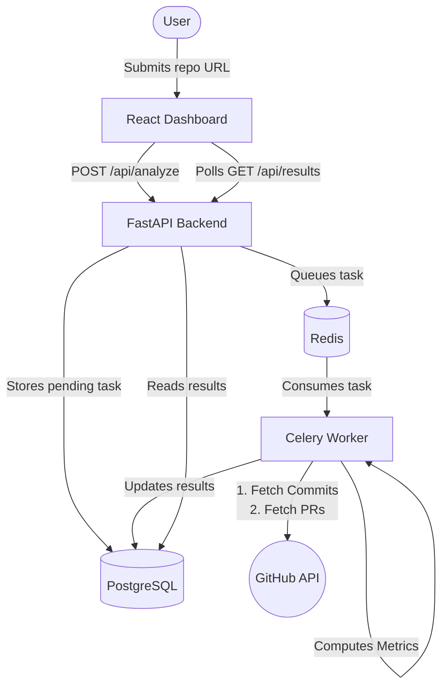
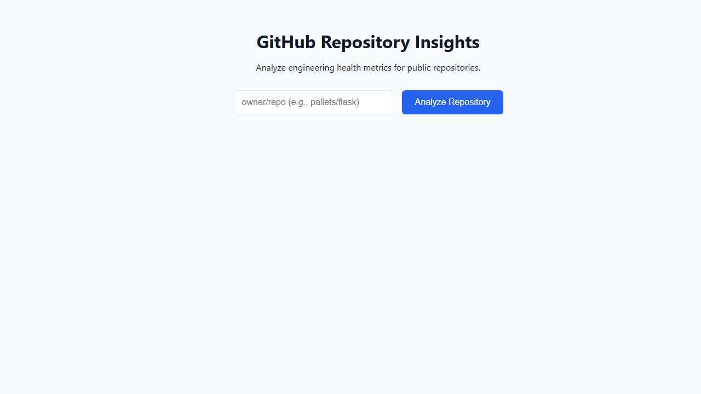
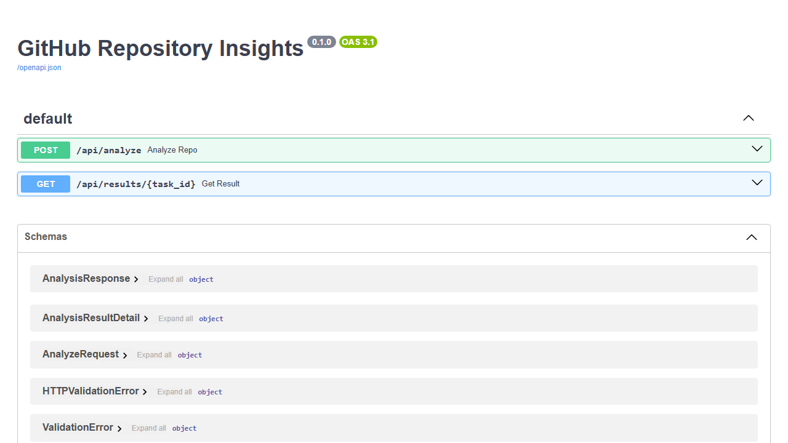

# GitHub Repository Insights

A full-stack service that analyzes public GitHub repositories to surface key engineering health metrics: Bus Factor, hot files (highest-churn files), and average pull request lifetime. By identifying critical bottlenecks and highly active files, it helps engineering teams proactively manage risk and optimize their maintenance efforts.

## Architecture



## Quickstart

To run the entire stack locally with zero manual fixes, ensure you have Docker installed and run:

```bash
docker-compose up -d --build
```

The services will be available at:
- **Frontend Dashboard:** http://localhost:3000
- **API Swagger Docs:** http://localhost:8000/docs

## API Example

Submit an analysis job via the API:

```bash
curl -X POST http://localhost:8000/api/analyze \
     -H "Content-Type: application/json" \
     -d '{"repo": "encode/starlette"}'
```

**Response:**
```json
{
  "task_id": "1e9bb8b8-39e5-47f6-b2d9-1d4a0a38f9f6",
  "status": "pending"
}
```

Wait a few seconds, then fetch the results:

```bash
curl http://localhost:8000/api/results/1e9bb8b8-39e5-47f6-b2d9-1d4a0a38f9f6
```

**Result:**
```json
{
  "id": "1e9bb8b8-39e5-47f6-b2d9-1d4a0a38f9f6",
  "repo_name": "encode/starlette",
  "status": "completed",
  "bus_factor": 1,
  "hot_files": [
    {
      "file": "tests/test_requests.py",
      "changes": 4
    },
    {
      "file": "starlette/requests.py",
      "changes": 3
    }
  ],
  "avg_pr_lifetime_hours": 124.5,
  "created_at": "2026-08-03T08:24:00.123456",
  "completed_at": "2026-08-03T08:24:05.654321",
  "error_message": null
}
```

## Screenshots

### React Dashboard


### FastAPI Swagger UI


## Engineering Notes

- **GitHub API Rate Limiting**: The unauthenticated GitHub REST API is strictly limited to 60 requests per hour per IP. To avoid hitting this limit instantly, the backend fetches 100 commits per page in a single call, and limits "hot file" evaluation to the latest 30 commits to prevent making 100 separate requests for commit diffs. You can provide a `GITHUB_TOKEN` environment variable in `docker-compose.yml` to increase the limit to 5,000/hr.
- **Bus Factor Formula**: Calculated by counting author occurrences, sorting descending, and finding the minimum number of distinct developers required to account for exactly 50% or more of the fetched commits.
- **Local Fallback Mode**: The backend is designed with a hybrid execution path. If `docker-compose` is unavailable, you can run the FastAPI app locally with SQLite. It dynamically detects SQLite and executes the Celery task synchronously, eliminating the strict dependency on Redis for local development.

## Testing & CI

This repository uses `pytest` for backend unit testing. GitHub Actions is configured to run the test suite and enforce code style on every pull request to the `main` branch.

To run tests locally:
```bash
cd backend
python -m venv venv
source venv/bin/activate # or venv\Scripts\Activate.ps1 on Windows
pip install -r requirements.txt
python -m pytest
```

## License

This project is licensed under the MIT License - see the [LICENSE](LICENSE) file for details.